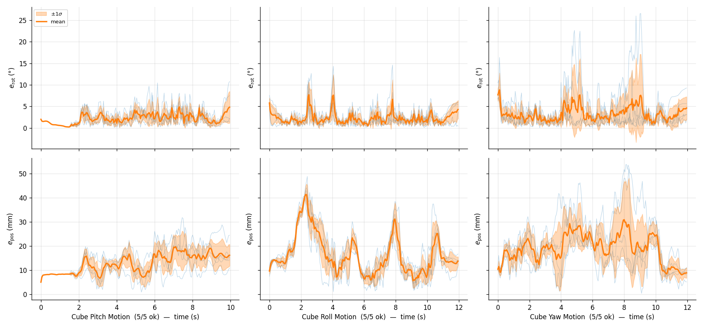
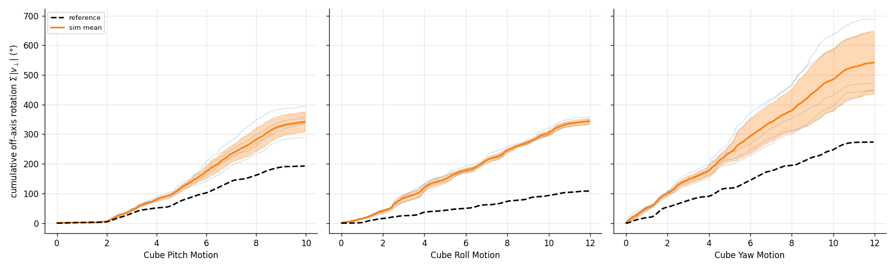
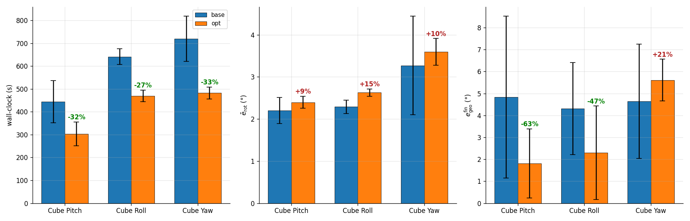
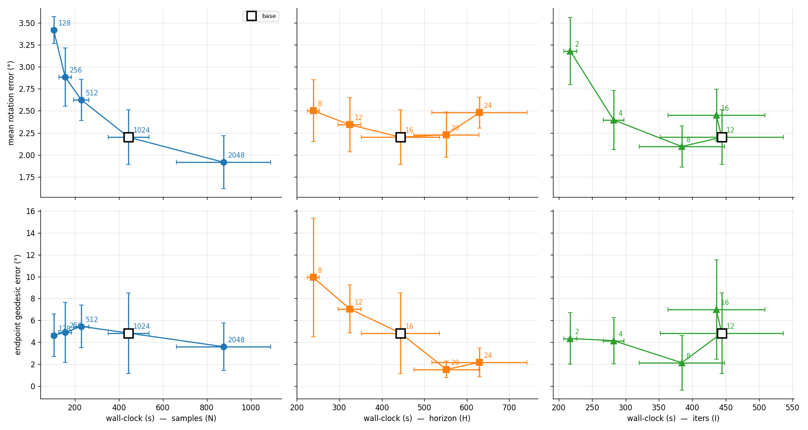

# Sweep analysis

_Generated by `scripts/evaluation/analyze_sweeps.py`._  
_Figures saved to `documents/figures/`._

## Metric glossary

- $n_{\text{ok}}/n$ — success rate. A run counts as success only if it completed the full reference length AND $e_{\text{pos}}^{\max} < 100\,$mm. Early-stopped runs (frac_term$=1$) count as failures.
- $\bar{e}_{\text{rot}}$, $e_{\text{rot}}^{\max}$ — per-tick cube orientation error vs reference, mean and max over the trajectory.
- $\bar{e}_{\text{pos}}$, $e_{\text{pos}}^{\max}$ — same for translation.
- $C_{\parallel}$ — *along-axis* rotation coverage. Per-tick rotation increments are projected onto the dominant axis of the reference's total rotation; $C_{\parallel}$ is the ratio $\sum_t \lvert v_{\parallel}^{\text{sim},t}\rvert / \sum_t \lvert v_{\parallel}^{\text{ref},t}\rvert$. $\sim 1$ means the cube executed the captured rotation; $>1$ over-rotated along the axis; $<1$ under-rotated.
- $C_{\perp}$ — *perpendicular* (off-axis) rotation coverage. Same construction but using the perpendicular component of each increment, $\lvert v_{\perp}\rvert = \lVert v - (v\cdot\hat a)\hat a\rVert$. $\sim 1$ means the sim adds about as much off-axis wobble as the reference does; $\gg 1$ means the planner introduces incidental rotation around axes the human didn't.
- $e_{\text{geo}}^{\text{fin}}$ — geodesic orientation error at the final tick (endpoint pose accuracy).
- $T_{\text{wall}}$ — total run time, seconds.
- All ± values are mean ± std over 5 seeds.

## Base runs (5 seeds × 3 motions)

| motion | $n_{\text{ok}}/n$ | $\bar{e}_{\text{rot}}$ (°) | $e_{\text{rot}}^{\max}$ (°) | $\bar{e}_{\text{pos}}$ (mm) | $e_{\text{pos}}^{\max}$ (mm) | $C_{\parallel}$ | $C_{\perp}$ | $e_{\text{geo}}^{\text{fin}}$ (°) | $T_{\text{wall}}$ (s) |
| --- | --- | --- | --- | --- | --- | --- | --- | --- | --- |
| Cube Pitch Motion | 5/5 | 2.20 ± 0.31 | 8.7 ± 2.0 | 12.8 ± 1.1 | 27.5 ± 2.7 | 1.07 ± 0.02 | 1.78 ± 0.18 | 4.83 ± 3.68 | 444 ± 92 |
| Cube Roll Motion | 5/5 | 2.29 ± 0.16 | 12.0 ± 3.0 | 16.3 ± 0.9 | 43.2 ± 3.2 | 1.21 ± 0.04 | 3.17 ± 0.08 | 4.31 ± 2.10 | 641 ± 35 |
| Cube Yaw Motion | 5/5 | 3.27 ± 1.17 | 14.7 ± 8.1 | 19.1 ± 3.5 | 40.0 ± 10.5 | 1.63 ± 0.29 | 1.98 ± 0.38 | 4.64 ± 2.61 | 719 ± 99 |

Per-tick `rot_err` and `pos_err` over time (individual seeds in blue, mean ± std in orange):

Off-axis wobble: cumulative magnitude of rotation perpendicular to each motion's dominant axis. Reference (dashed black) accumulates slowly; sim (orange) grows faster — the gap is the incidental wobble the planner introduces.

## Optimal config vs base (5 seeds × 3 motions)

Base config: $N=1024$, $H=16$, iters$=12$. Optimal config (from the MPPI Pareto on cube_pitch2): $N=512$, $H=20$, iters$=8$. Reward weights, physics, all other settings identical between the two runs.

| motion | $n_{\text{ok}}/n$ base→opt | $T_{\text{wall}}$ (s) base→opt | $\bar{e}_{\text{rot}}$ (°) base→opt | $e_{\text{geo}}^{\text{fin}}$ (°) base→opt | $C_{\perp}$ base→opt |
| --- | --- | --- | --- | --- | --- |
| Cube Pitch Motion | 5/5 → 5/5 | 444 ± 92 → 303 ± 52 (-32%) | 2.20 ± 0.31 → 2.40 ± 0.14 (+9%) | 4.83 ± 3.68 → 1.81 ± 1.57 (-63%) | 1.78 ± 0.18 → 1.65 ± 0.07 (-7%) |
| Cube Roll Motion | 5/5 → 5/5 | 641 ± 35 → 469 ± 26 (-27%) | 2.29 ± 0.16 → 2.63 ± 0.08 (+15%) | 4.31 ± 2.10 → 2.30 ± 2.13 (-47%) | 3.17 ± 0.08 → 3.50 ± 0.23 (+10%) |
| Cube Yaw Motion | 5/5 → 5/5 | 719 ± 99 → 482 ± 26 (-33%) | 3.27 ± 1.17 → 3.59 ± 0.32 (+10%) | 4.64 ± 2.61 → 5.61 ± 0.95 (+21%) | 1.98 ± 0.38 → 2.00 ± 0.11 (+1%) |

Side-by-side bars per motion. Green = improvement, red = regression vs base:

## MPPI sweep — cube_pitch2 (5 seeds per config)

### N (samples) sweep — H=16, iters=12 fixed

| N (samples) | $n_{\text{ok}}/n$ | $\bar{e}_{\text{rot}}$ (°) | $e_{\text{rot}}^{\max}$ (°) | $\bar{e}_{\text{pos}}$ (mm) | $e_{\text{pos}}^{\max}$ (mm) | $C_{\parallel}$ | $C_{\perp}$ | $e_{\text{geo}}^{\text{fin}}$ (°) | $T_{\text{wall}}$ (s) |
| --- | --- | --- | --- | --- | --- | --- | --- | --- | --- |
| **N=128** | 5/5 | 3.42 ± 0.15 | 12.9 ± 2.0 | 11.9 ± 1.4 | 25.8 ± 4.0 | 1.12 ± 0.02 | 1.83 ± 0.12 | 4.63 ± 1.95 | 103 ± 10 |
| **N=256** | 5/5 | 2.88 ± 0.33 | 11.4 ± 0.7 | 12.1 ± 1.3 | 25.4 ± 5.2 | 1.09 ± 0.02 | 1.72 ± 0.08 | 4.90 ± 2.74 | 155 ± 28 |
| **N=512** | 5/5 | 2.63 ± 0.23 | 10.4 ± 0.9 | 11.9 ± 0.6 | 25.2 ± 2.1 | 1.07 ± 0.01 | 1.68 ± 0.13 | 5.45 ± 1.95 | 228 ± 34 |
| **N=2048** | 5/5 | 1.92 ± 0.30 | 8.3 ± 1.6 | 12.0 ± 0.9 | 22.7 ± 3.2 | 1.04 ± 0.01 | 1.58 ± 0.12 | 3.59 ± 2.18 | 876 ± 215 |
| *base* | 5/5 | 2.20 ± 0.31 | 8.7 ± 2.0 | 12.8 ± 1.1 | 27.5 ± 2.7 | 1.07 ± 0.02 | 1.78 ± 0.18 | 4.83 ± 3.68 | 444 ± 92 |

### H (horizon) sweep — N=1024, iters=12 fixed

| H (horizon steps) | $n_{\text{ok}}/n$ | $\bar{e}_{\text{rot}}$ (°) | $e_{\text{rot}}^{\max}$ (°) | $\bar{e}_{\text{pos}}$ (mm) | $e_{\text{pos}}^{\max}$ (mm) | $C_{\parallel}$ | $C_{\perp}$ | $e_{\text{geo}}^{\text{fin}}$ (°) | $T_{\text{wall}}$ (s) |
| --- | --- | --- | --- | --- | --- | --- | --- | --- | --- |
| **H=8** | 5/5 | 2.50 ± 0.35 | 12.3 ± 2.9 | 14.0 ± 0.5 | 29.3 ± 2.4 | 1.05 ± 0.02 | 1.51 ± 0.05 | 9.93 ± 5.42 | 239 ± 13 |
| **H=12** | 5/5 | 2.34 ± 0.31 | 10.7 ± 2.3 | 12.8 ± 0.7 | 26.4 ± 4.0 | 1.06 ± 0.02 | 1.57 ± 0.12 | 7.05 ± 2.20 | 324 ± 27 |
| **H=20** | 5/5 | 2.23 ± 0.26 | 9.1 ± 0.9 | 12.0 ± 1.2 | 24.7 ± 2.7 | 1.06 ± 0.02 | 1.60 ± 0.06 | 1.51 ± 0.76 | 552 ± 76 |
| **H=24** | 5/5 | 2.48 ± 0.17 | 10.8 ± 1.3 | 11.4 ± 1.5 | 23.4 ± 3.5 | 1.08 ± 0.02 | 1.69 ± 0.07 | 2.17 ± 1.30 | 630 ± 112 |
| *base* | 5/5 | 2.20 ± 0.31 | 8.7 ± 2.0 | 12.8 ± 1.1 | 27.5 ± 2.7 | 1.07 ± 0.02 | 1.78 ± 0.18 | 4.83 ± 3.68 | 444 ± 92 |

### iters sweep — N=1024, H=16 fixed

| iters | $n_{\text{ok}}/n$ | $\bar{e}_{\text{rot}}$ (°) | $e_{\text{rot}}^{\max}$ (°) | $\bar{e}_{\text{pos}}$ (mm) | $e_{\text{pos}}^{\max}$ (mm) | $C_{\parallel}$ | $C_{\perp}$ | $e_{\text{geo}}^{\text{fin}}$ (°) | $T_{\text{wall}}$ (s) |
| --- | --- | --- | --- | --- | --- | --- | --- | --- | --- |
| **I=2** | 5/5 | 3.18 ± 0.38 | 13.6 ± 3.3 | 12.8 ± 0.9 | 24.5 ± 2.4 | 1.09 ± 0.02 | 1.57 ± 0.04 | 4.34 ± 2.36 | 217 ± 10 |
| **I=4** | 5/5 | 2.40 ± 0.34 | 14.3 ± 7.3 | 12.5 ± 1.1 | 24.0 ± 3.3 | 1.06 ± 0.01 | 1.51 ± 0.06 | 4.14 ± 2.09 | 282 ± 16 |
| **I=8** | 5/5 | 2.10 ± 0.23 | 12.2 ± 7.4 | 11.6 ± 1.1 | 22.7 ± 2.4 | 1.05 ± 0.01 | 1.58 ± 0.07 | 2.12 ± 2.50 | 384 ± 64 |
| **I=16** | 5/5 | 2.45 ± 0.29 | 9.9 ± 2.6 | 12.7 ± 0.7 | 24.9 ± 2.1 | 1.05 ± 0.01 | 1.55 ± 0.08 | 6.98 ± 4.56 | 436 ± 73 |
| *base* | 5/5 | 2.20 ± 0.31 | 8.7 ± 2.0 | 12.8 ± 1.1 | 27.5 ± 2.7 | 1.07 ± 0.02 | 1.78 ± 0.18 | 4.83 ± 3.68 | 444 ± 92 |

#### Early-stopping usage per iters configuration

Configured max iters vs how many MPPI actually consumed on average per tick. Where actual usage is well below the cap, the SPIDER-style improvement-threshold early stop is firing (rew_max is NaN-padded for unused iterations).

| sweep point | $M_{\max}$ | $\langle M_{\text{used}}\rangle$ | $M_{\text{used}}/M_{\max}$ | $n_{\text{ok}}/n$ | $\bar{e}_{\text{rot}}$ (°) | $e_{\text{geo}}^{\text{fin}}$ (°) | $T_{\text{wall}}$ (s) |
| --- | --- | --- | --- | --- | --- | --- | --- |
| **I=2** | 2 | 1.54 ± 0.03 | 77% | 5/5 | 3.18 ± 0.38 | 4.34 ± 2.36 | 217 ± 10 |
| **I=4** | 4 | 2.25 ± 0.12 | 56% | 5/5 | 2.40 ± 0.34 | 4.14 ± 2.09 | 282 ± 16 |
| **I=8** | 8 | 3.18 ± 0.45 | 40% | 5/5 | 2.10 ± 0.23 | 2.12 ± 2.50 | 384 ± 64 |
| **I=16** | 16 | 3.57 ± 0.50 | 22% | 5/5 | 2.45 ± 0.29 | 6.98 ± 4.56 | 436 ± 73 |
| *base* | 12 | 3.71 ± 0.67 | 31% | 5/5 | 2.20 ± 0.31 | 4.83 ± 3.68 | 444 ± 92 |

Compute vs tracking — one panel per swept axis, base marked ★:

## Physics sweep — cube edge length (Cube Pitch Motion, 5 seeds)

Base cube edge is 70 mm (XML default).

| edge | $n_{\text{ok}}/n$ | $\bar{e}_{\text{rot}}$ (°) | $e_{\text{rot}}^{\max}$ (°) | $\bar{e}_{\text{pos}}$ (mm) | $e_{\text{pos}}^{\max}$ (mm) | $C_{\parallel}$ | $C_{\perp}$ | $e_{\text{geo}}^{\text{fin}}$ (°) | $T_{\text{wall}}$ (s) |
| --- | --- | --- | --- | --- | --- | --- | --- | --- | --- |
| **50 mm** | 4/5 | 2.97 ± 0.33 | 8.8 ± 2.7 | 10.9 ± 2.2 | 22.5 ± 7.6 | 1.21 ± 0.02 | 2.25 ± 0.10 | 1.81 ± 0.86 | 502 ± 251 |
| **60 mm** | 5/5 | 2.99 ± 0.58 | 16.5 ± 7.2 | 10.0 ± 1.3 | 26.0 ± 3.4 | 1.16 ± 0.03 | 1.98 ± 0.14 | 1.22 ± 0.63 | 574 ± 43 |
| **80 mm** | 1/5 | 4.00 ± 0.60 | 26.3 ± 2.0 | 17.9 ± 2.0 | 48.2 ± 1.9 | 1.38 ± 0.08 | 5.18 ± 1.66 | 4.60 ± 3.05 | 1087 ± 415 |
| **90 mm** | 0/5 | 5.01 ± 0.91 | 21.9 ± 5.9 | 17.1 ± 1.3 | 37.5 ± 12.0 | 1.60 ± 0.07 | 7.00 ± 0.19 | 15.33 ± 5.47 | 931 ± 94 |
| *base* | 5/5 | 2.20 ± 0.31 | 8.7 ± 2.0 | 12.8 ± 1.1 | 27.5 ± 2.7 | 1.07 ± 0.02 | 1.78 ± 0.18 | 4.83 ± 3.68 | 444 ± 92 |

## Physics sweep — cube mass (Cube Pitch Motion, 5 seeds)

Base cube mass is 40 g (XML default).

| mass | $n_{\text{ok}}/n$ | $\bar{e}_{\text{rot}}$ (°) | $e_{\text{rot}}^{\max}$ (°) | $\bar{e}_{\text{pos}}$ (mm) | $e_{\text{pos}}^{\max}$ (mm) | $C_{\parallel}$ | $C_{\perp}$ | $e_{\text{geo}}^{\text{fin}}$ (°) | $T_{\text{wall}}$ (s) |
| --- | --- | --- | --- | --- | --- | --- | --- | --- | --- |
| **20 g** | 5/5 | 2.13 ± 0.22 | 9.7 ± 2.8 | 12.7 ± 0.7 | 25.3 ± 3.5 | 1.05 ± 0.01 | 1.63 ± 0.07 | 4.14 ± 1.97 | 452 ± 58 |
| **80 g** | 5/5 | 2.18 ± 0.15 | 9.3 ± 1.2 | 12.7 ± 0.7 | 26.0 ± 3.7 | 1.06 ± 0.01 | 1.68 ± 0.04 | 2.58 ± 1.69 | 481 ± 42 |
| **160 g** | 5/5 | 1.89 ± 0.07 | 7.8 ± 1.6 | 14.1 ± 1.0 | 28.1 ± 2.8 | 1.06 ± 0.02 | 1.75 ± 0.05 | 1.41 ± 1.51 | 519 ± 43 |
| *base* | 5/5 | 2.20 ± 0.31 | 8.7 ± 2.0 | 12.8 ± 1.1 | 27.5 ± 2.7 | 1.07 ± 0.02 | 1.78 ± 0.18 | 4.83 ± 3.68 | 444 ± 92 |

